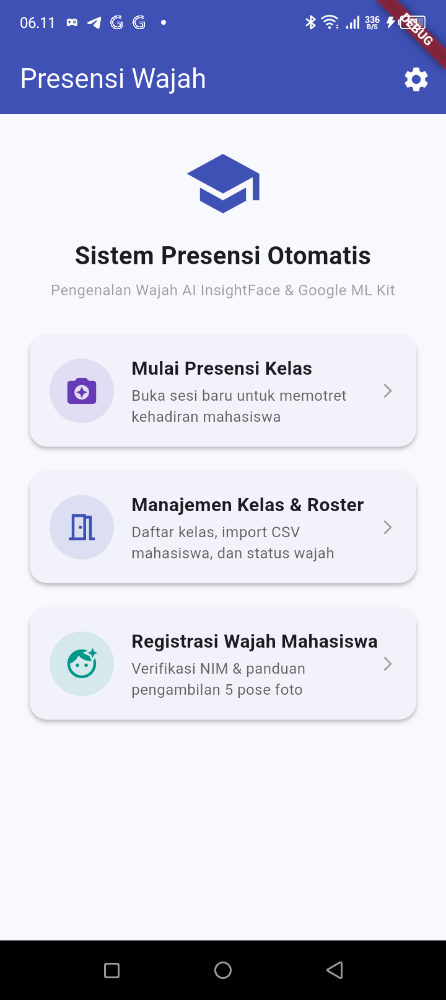
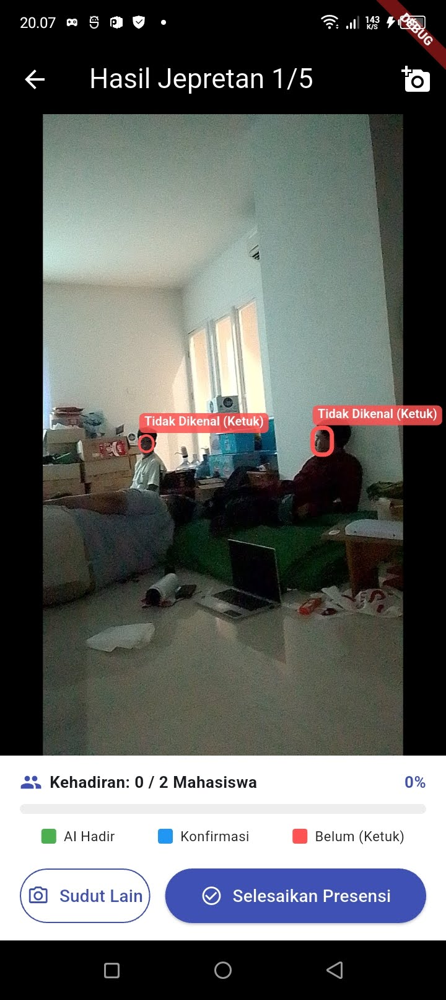
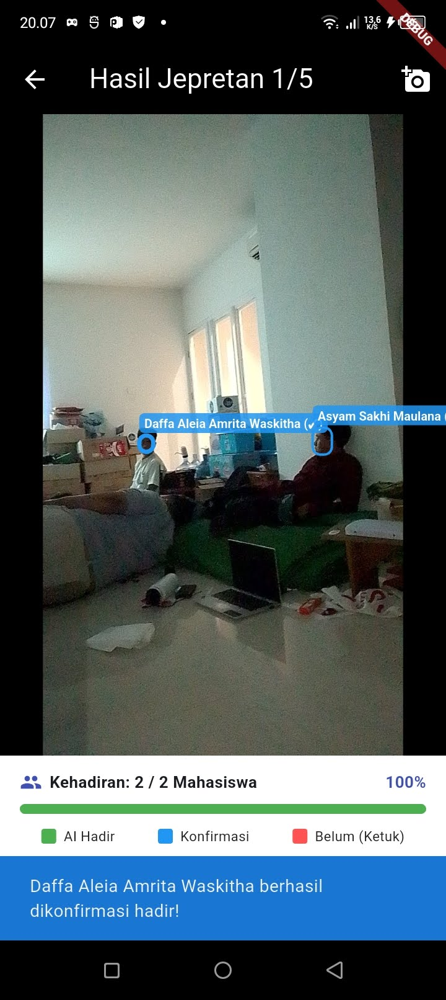

# 🎓 SnapAttend V3 — Sistem Presensi Wajah Cerdas Berbasis AI (InsightFace & Edge Sensor HUD)

<div align="center">


<p align="center">
  <b>Solusi Mutakhir Presensi Kelas Cepat, Akurat, dan Anti-Titip Absen Menggunakan Deep Learning Multi-Face Recognition, Live Sensor HUD (X, Y, Z), Auto-Capture Hands-Free, dan Gamifikasi Poin Disiplin Mahasiswa.</b>
</p>

</div>

---

## 📌 Daftar Isi
1. [Ringkasan Eksekutif](#-ringkasan-eksekutif)
2. [Fitur-Fitur Utama SnapAttend V3](#-fitur-fitur-utama-snapattend-v3)
3. [Live Sensor HUD X, Y, Z & Auto-Capture](#-live-sensor-hud-x-y-z--auto-capture)
4. [Live Multi-Face Classroom Detection](#-live-multi-face-classroom-detection)
5. [Arsitektur Sistem & Alur Pengenalan Wajah](#-arsitektur-sistem--alur-pengenalan-wajah)
6. [Galeri Demo & Tampilan Aplikasi](#-galeri-demo--tampilan-aplikasi)
7. [Panduan Penggunaan (Dosen & Mahasiswa)](#-panduan-penggunaan-dosen--mahasiswa)
8. [Panduan Instalasi & Menjalankan Sistem](#-panduan-instalasi--menjalankan-sistem)
9. [Mode Konektivitas Jaringan (USB vs Wi-Fi LAN)](#-mode-konektivitas-jaringan-usb-vs-wi-fi-lan)
10. [Dokumentasi Endpoint RESTful API Backend](#-dokumentasi-endpoint-restful-api-backend)
11. [Struktur Repositori](#-struktur-repositori)
12. [Lisensi & Penulis](#-lisensi--penulis)

---

## 💡 Ringkasan Eksekutif

Presensi konvensional secara manual di ruang perkuliahan seringkali memakan waktu berharga dosen (10–15 menit per sesi) serta rentan terhadap manipulasi "titip absen". 

**SnapAttend V3** hadir sebagai platform presensi modern berbasis *Computer Vision* dan *Edge AI*:
* **Hanya Butuh 1–2 Kali Jepret Foto Kelas**: Dosen cukup mengarahkan kamera ke ruang kelas.
* **Batch Multi-Face AI Recognition**: Mesin deep learning *InsightFace Buffalo_L* mendeteksi puluhan wajah sekaligus dalam citra beresolusi tinggi, mengekstrak vektor *ArcFace* 512 dimensi, dan mencocokkannya ke database secara instan.
* **Algoritma Hungarian Bipartite Matching**: Menjamin tidak ada mahasiswa ganda yang terabsensi pada dua wajah berdekatan (optimal global assignment).
* **Live Sensor HUD X, Y, Z (Edge ML Kit)**: Memandu registrasi 5 pose wajah mahasiswa dengan visualisasi sudut kemiringan live, status akurasi *Dapat* vs *Target*, dan penjepretan otomatis (*Hands-Free Auto-Capture*).
* **Lingkaran Wajah Live Kelas (*Bunder-Bunder Wajah*)**: Kamera kelas dosen dilengkapi pelacakan multi-wajah live stream dengan indikator visual dinamis dan penghitung wajah otomatis.
* **Sistem Poin Disiplin & Papan Peringkat**: Mengintegrasikan gamifikasi reward (+10 poin hadir, -10 poin jika alpa) yang terpantau pada Leaderboard kelas.

---

## 🚀 Fitur-Fitur Utama SnapAttend V3

* 🔒 **Tampilan Bersih Siap Produksi (Production Ready)**: Antarmuka bersih tanpa kartu dummy atau bypass prototype. Seluruh autentikasi mahasiswa dan dosen menggunakan hashing keamanan modern.
* 🧭 **Live Sensor HUD (Sumbu X, Y, Z)**:
  * **Sumbu X (Pitch)**: Evaluasi sudut menunduk / mendongak.
  * **Sumbu Y (Yaw)**: Evaluasi sudut menengok kiri / kanan.
  * **Sumbu Z (Roll & Jarak)**: Evaluasi kemiringan kepala dan jarak kedalaman wajah ke lensa kamera.
  * **Status Real-time**: Menampilkan nilai terbaca (*Dapat*) berdampingan dengan nilai target (*Target*) beserta badge `[PAS]` atau `[SESUAIKAN]`.
* ⚡ **Auto-Capture Hands-Free**: Saat ketiga sumbu X, Y, Z terpenuhi dan posisi wajah terkunci (`TERKUNCI`), sistem menjalankan countdown animasi ~0.8 detik dan menjepret foto otomatis tanpa harus menyentuh tombol. Shutter manual tetap tersedia kapan saja.
* 🔄 **Dukungan Kamera Depan & Belakang**: Tombol flip kamera instan pada pendaftaran selfie maupun pemotretan kelas.
* 🟢 **Pelacakan Multi-Wajah Live Kelas (*Live Face Circles*)**: Kamera kelas dosen secara langsung menampilkan lingkaran target neon emerald (*Bunder-Bunder Wajah*) pada setiap mahasiswa yang terdeteksi di ruang kelas beserta chip penghitung live (`Live AI: X Wajah Terdeteksi`).
* 📸 **Batch Multi-Face InsightFace Engine**: Mampu mengenali puluhan wajah mahasiswa sekaligus dalam satu kali foto ruangan kelas.
* 🎯 **Algoritma Hungarian (Bipartite Graph Matching)**: Optimasi penugasan wajah global untuk akurasi pencocokan 1-to-1 yang adil tanpa duplikasi.
* 🔄 **Merge-Max Multi-Capture (Hingga 5 Sudut Foto)**: Dosen dapat mengambil foto dari berbagai sudut (depan, kiri, kanan, tengah). Sistem secara otomatis menggabungkan skor kemiripan tertinggi (*highest similarity score*) dari tiap mahasiswa.
* 📶 **Konektivitas Fleksibel Ganda (USB & Wi-Fi)**:
  * **Mode USB Reverse Tunnel**: 100% offline tanpa internet, tahan blokir firewall kampus.
  * **Mode Wi-Fi Direct LAN**: Komunikasi nirkabel penuh melalui jaringan lokal berkecepatan tinggi.

---

## 🧭 Live Sensor HUD X, Y, Z & Auto-Capture

Pada modul pendaftaran 5-pose mahasiswa (`capture_screen.dart`), pengguna dipandu oleh modul visual sensor cerdas:

```text
┌────────────────────────────────────────────────────────┐
│  ● LIVE SENSOR HUD (X, Y, Z)            [🔒 TERKUNCI]  │
├────────────────────────────────────────────────────────┤
│  ↕ X (Pitch)   Dapat: +2°    Target: ±15°      [ PAS ] │
│  ↔ Y (Yaw)     Dapat: -1°    Target: ±15°      [ PAS ] │
│  ⤢ Z (Roll/Jrk) Dapat: 0°|28% Target: Roll±18° [ PAS ] │
├────────────────────────────────────────────────────────┤
│  [=======================] 100%                        │
│  Posisi Sempurna! Otomatis mengambil foto dalam 0.8s...│
└────────────────────────────────────────────────────────┘
```

1. **Sumbu X (Pitch)**: Mendeteksi sudut elevasi kepala (menunduk/mendongak).
2. **Sumbu Y (Yaw)**: Mendeteksi sudut azimut kepala (menoleh kiri/kanan).
3. **Sumbu Z (Roll & Distance)**: Mendeteksi kemiringan lateral dan rasio jarak kedalaman wajah terhadap bidang tangkap kamera.
4. **Indikator Cincin Shutter**: Lingkaran luar tombol shutter berputar mengisi progres hijau saat posisi terkunci hingga capture tereksekusi otomatis.

---

## 👥 Live Multi-Face Classroom Detection

Pada kamera presensi kelas dosen (`attendance_camera_screen.dart`), sistem mengalirkan *Live Camera Stream* dengan pemrosesan frame berkecepatan tinggi via Google ML Kit:
* Setiap wajah mahasiswa di kelas secara *real-time* diberi lingkaran target visual dinamis (*bunder-bunder wajah*).
* Chip info live menampilkan jumlah mahasiswa yang tertangkap di bidang pandang: `Live AI: N Wajah Terdeteksi`.
* Dosen dapat menekan tombol shutter saat komposisi kelas sudah optimal untuk dikirim ke backend InsightFace.

---

## 🏗️ Arsitektur Sistem & Alur Pengenalan Wajah

Sistem memadukan komputasi ringan di sisi perangkat bergerak (*Client-Side Edge AI*) dengan kecerdasan komputasi mendalam di sisi server (*Server-Side Deep Learning*):

```mermaid
flowchart TD
    subgraph MobileApp [Aplikasi Mobile Flutter (SnapAttend V3)]
        A[Buka Sesi Presensi] --> B[Kamera Presensi Kelas]
        B -->|Live Frame Stream| B1[ML Kit Live Circles: Bunder-Bunder Wajah]
        B --> C[Kompresi EXIF & SHA-256 Hashing]
        C --> D[Kirim POST /attendance/recognize]
        H[Terima Hasil JSON] --> I[Gambar Bounding Box Hijau & Label AI]
        I --> J[Finalisasi Sesi Presensi]
    end

    subgraph BackendServer [Server AI FastAPI]
        D --> E[Decode Citra & InsightFace Detection]
        E --> F[Ekstraksi 512-D ArcFace Embeddings]
        F --> G[Hungarian Bipartite Matching vs Database]
        G --> H
        J --> K[Update Status Hadir & Perhitungan Poin]
        K --> L[(SQLite Database: presensi.db)]
    end
```

---

## 📱 Galeri Demo & Tampilan Aplikasi

| 1. Login Bersih (Production) | 2. Live Sensor HUD X,Y,Z | 3. Live Wajah Kelas | 4. Hasil AI Bounding Box |
| :---: | :---: | :---: | :---: |
|  |  |  |  |
| *Antarmuka login tanpa dummy/prototype, aman & siap rilis.* | *Live Sensor HUD X,Y,Z dengan perbandingan Dapat vs Target.* | *Lingkaran deteksi multi-wajah live stream pada ruang kelas.* | *Kotak hijau identitas AI dengan persentase kemiripan akurat.* |

---

## 📖 Panduan Penggunaan (Dosen & Mahasiswa)

### A. Alur Dosen (Presensi Kelas)
1. **Login Akun Dosen**: Masukkan email dan kata sandi dosen.
2. **Pilih Sesi Kelas**:
   * Pilih mata kuliah dan nomor pertemuan.
   * Tekan **Mulai Sesi Presensi**.
3. **Ambil Foto Kelas**:
   * Arahkan kamera ke seluruh mahasiswa di ruangan kelas.
   * Perhatikan indikator lingkaran live pada wajah-wajah mahasiswa yang terdeteksi.
   * Tekan tombol kamera (atau gunakan tombol ganti kamera jika perlu).
   * *(Opsional)* Ambil hingga 5 sudut foto untuk mencakup seluruh sudut kelas.
4. **Verifikasi & Finalisasi**:
   * Tinjau kotak hijau pengenalan AI.
   * Tekan **Selesaikan & Kunci Presensi** untuk menghitung poin kehadiran secara otomatis (+10 Poin hadir / -10 Poin alpa).

### B. Alur Mahasiswa (Pendaftaran Wajah Baru)
1. **Buka Menu Registrasi Wajah**:
   * Masukkan identitas NIM dan nama mahasiswa.
2. **Ikuti Panduan 5 Pose Wajah dengan Sensor HUD**:
   * **Pose 1 (Depan)**: Wajah lurus ke kamera.
   * **Pose 2 (Kiri)**: Tengokkan kepala sedikit ke kiri.
   * **Pose 3 (Kanan)**: Tengokkan kepala sedikit ke kanan.
   * **Pose 4 (Atas)**: Angkat dagu sedikit ke atas.
   * **Pose 5 (Bawah)**: Tundukkan kepala sedikit ke bawah.
3. **Auto-Capture**: Sistem akan otomatis mengambil foto begitu sumbu X, Y, Z terkunci dan dinyatakan `[PAS]`.
4. Setelah 5 pose selesai, sistem memverifikasi dan menyimpan vektor wajah terenkripsi ke database server.

---

## 💻 Panduan Instalasi & Menjalankan Sistem

### Prasyarat:
* **Python**: Versi 3.10 atau 3.11.
* **Flutter SDK**: Versi 3.24+ / 3.x.
* **Android SDK & Platform Tools (ADB)**.
* **File APK Rilis**: `SnapAttend-v3.apk` (Tersedia langsung di root direktori proyek).

---

### 1. Menjalankan Server Backend (FastAPI)

1. Buka terminal dan masuk ke folder `backend`:
   ```powershell
   cd d:\apilkasi-absensi\backend
   ```
2. Aktifkan Virtual Environment:
   ```powershell
   .\.venv\Scripts\Activate.ps1
   ```
3. Jalankan server:
   ```powershell
   uvicorn app.main:app --host 0.0.0.0 --port 8000 --reload
   ```
4. Akses Swagger UI Dokumentasi API:
   👉 **`http://localhost:8000/docs`**

---

### 2. Memasang & Menjalankan Aplikasi Mobile (SnapAttend V3)

* **Opsi A: Memasang APK Siap Pakai Langsung ke HP (Paling Cepat)**
  Pastikan HP tertancap dengan USB Debugging aktif:
  ```powershell
  adb install -r d:\apilkasi-absensi\SnapAttend-v3.apk
  ```

* **Opsi B: Menjalankan dari Source Code (Debug Mode)**
  ```powershell
  cd d:\apilkasi-absensi\mobile
  flutter pub get
  flutter run
  ```

---

## 🔌 Mode Konektivitas Jaringan (USB vs Wi-Fi LAN)

Aplikasi memiliki menu pengaturan alamat IP server yang dapat diakses melalui ikon gerigi ⚙️ di pojok kanan atas layar login:

### ⚡ Opsi 1: Mode USB Kabel (ADB Reverse) — Paling Stabil & 100% Offline
Sangat cocok untuk lingkungan kampus dengan jaringan Wi-Fi berkeamanan tinggi yang memblokir komunikasi antardevice (*AP Client Isolation*).
1. Hubungkan HP ke laptop via kabel USB data (aktifkan USB Debugging).
2. Jalankan perintah port forward di PowerShell laptop:
   ```powershell
   adb reverse tcp:8000 tcp:8000
   ```
3. Di aplikasi HP, buka menu **Pengaturan Server** (ikon ⚙️) -> masukkan URL:
   ```text
   http://127.0.0.1:8000
   ```
4. Tekan **Simpan & Tes Koneksi** hingga muncul notifikasi hijau `Koneksi Berhasil!`.

### 📶 Opsi 2: Mode Wi-Fi Lokal / LAN (Nirkabel Penuh Tanpa Kabel)
Cocok digunakan jika laptop dan HP terhubung pada satu router Wi-Fi yang sama (atau Laptop tersambung ke Hotspot HP):
1. Cek alamat IP lokal laptop Anda melalui `ipconfig` pada adapter Wi-Fi:
   *(Format: `192.168.***.***`)*
2. Di aplikasi HP, buka menu **Pengaturan Server** (ikon ⚙️) -> masukkan URL Wi-Fi laptop:
   ```text
   http://192.168.***.***:8000
   ```
   *(Ganti `***.***` dengan angka segmen IP Wi-Fi laptop Anda)*
3. Tekan **Simpan & Tes Koneksi** hingga muncul notifikasi hijau `Koneksi Berhasil!`.

---

## 📡 Dokumentasi Endpoint RESTful API Backend

| Metode | Endpoint | Deskripsi | Status Sukses |
| :---: | :--- | :--- | :---: |
| `GET` | `/health` | Pemeriksaan status server & ketersediaan model AI InsightFace | `200 OK` |
| `POST` | `/auth/login` | Autentikasi akun Dosen / Mahasiswa (JWT Token) | `200 OK` |
| `GET` | `/classes` | Mengambil daftar seluruh kelas & mata kuliah aktif | `200 OK` |
| `POST` | `/students/{id}/faces` | Mendaftarkan 5 foto pose wajah mahasiswa | `201 Created` |
| `POST` | `/sessions` | Membuka sesi presensi kelas baru | `201 Created` |
| `GET` | `/sessions/{id}` | Mengambil detail sesi, daftar hadir, dan rekapan | `200 OK` |
| `POST` | `/attendance/recognize` | Mengunggah foto kelas & pencocokan multi-wajah AI | `200 OK` |
| `POST` | `/sessions/{id}/finalize` | Menutup & mengunci presensi serta kalkulasi poin disiplin | `200 OK` |
| `GET` | `/points?class_id={id}` | Mengambil data Leaderboard peringkat kedisiplinan kelas | `200 OK` |

---

## 📁 Struktur Repositori

```text
apilkasi-absensi/
├── SnapAttend-v3.apk               # File Rilis Final Siap Install Android
├── backend/                        # Layanan Backend AI (Python / FastAPI)
│   ├── app/
│   │   ├── core/                   # Konfigurasi, Database Engine, & Keamanan
│   │   ├── models/                 # Model Tabel SQLAlchemy ORM
│   │   ├── routers/                # Endpoint API (Attendance, Auth, Classes, Points, Students)
│   │   ├── schemas/                # Skema Validasi Pydantic
│   │   ├── services/               # Mesin InsightFace AI ArcFace & Algoritma Hungarian
│   │   └── main.py                 # Titik Masuk Utama Aplikasi FastAPI
│   ├── .env                        # Konfigurasi Hyperparameter AI
│   ├── presensi.db                 # Database SQLite Utama (Default Kosong Siap Pakai)
│   ├── requirements.txt            # Daftar Paket Pustaka Python
│   └── reset_db.py                 # Utilitas Pembersih & Reset Database Nol
├── docs/                           # Dokumentasi & Aset Visual
│   ├── images/                     # Tangkapan Layar Demo Resmi (PNG)
│   ├── DESIGN SPEC ... .md         # Dokumen Spesifikasi Desain Arsitektur Lengkap
│   └── MANUAL_BOOK_PANDUAN ... .md # Dokumen Manual Book Panduan Resmi Dosen & Mahasiswa
├── mobile/                         # Aplikasi Klien Android (Flutter / Dart)
│   ├── lib/
│   │   ├── app/                    # Routing, Tema Luxury, & Riverpod Providers
│   │   ├── core/                   # Utilitas Kualitas Citra, EXIF, & API Client
│   │   ├── features/
│   │   │   ├── attendance/         # Kamera Kelas Live Circles & Hasil AI
│   │   │   ├── auth/               # Autentikasi Bersih Siap Produksi
│   │   │   ├── classes/            # Manajemen Kelas, Roster, & Papan Peringkat
│   │   │   ├── registration/       # Registrasi 5 Pose dengan Live Sensor HUD (X, Y, Z)
│   │   │   └── settings/           # Pengaturan Server IP & Mode Jaringan
│   │   └── main.dart               # Titik Masuk Utama Aplikasi Flutter
│   └── pubspec.yaml                # Dependensi Mobile Flutter
├── .gitignore                      # Konfigurasi Eksklusi File Git
└── README.md                       # Dokumentasi Utama Proyek (File ini)
```

---

## 📄 Lisensi & Penulis

Proyek ini dikembangkan dan disempurnakan sebagai platform presensi cerdas terpadu berbasis kecerdasan buatan (*Artificial Intelligence*).

* **Pengembang**: Asyam Sakhi Maulana & Tim
* **Institusi**: Universitas Negeri Malang (UM)
* **Lisensi**: Terdistribusi di bawah lisensi terbuka [MIT License](LICENSE).

<div align="center">
  <sub>Dibuat dengan ❤️ untuk kemajuan efisiensi, inovasi, dan transparansi pendidikan Indonesia.</sub>
</div>
