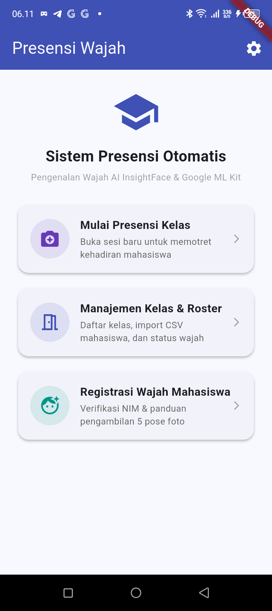
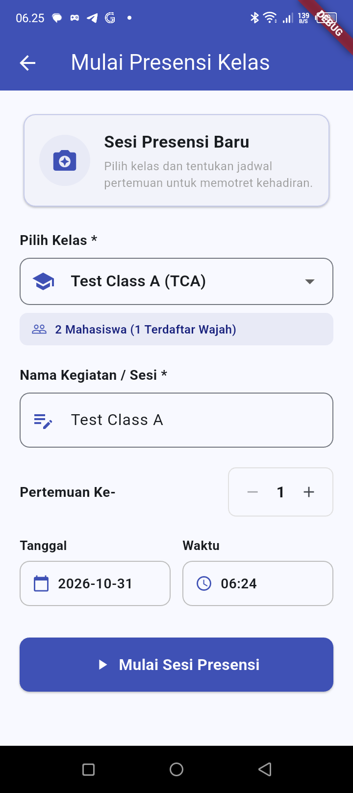
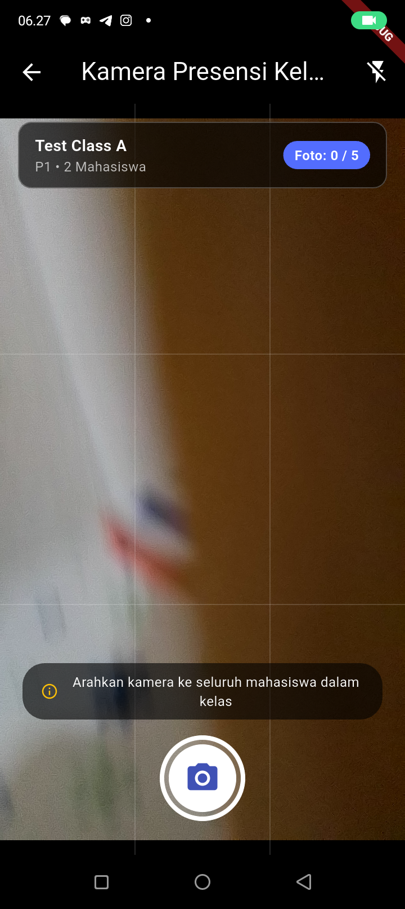
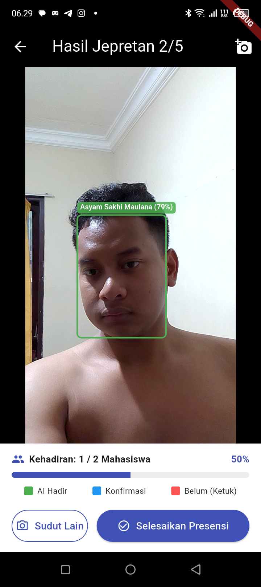
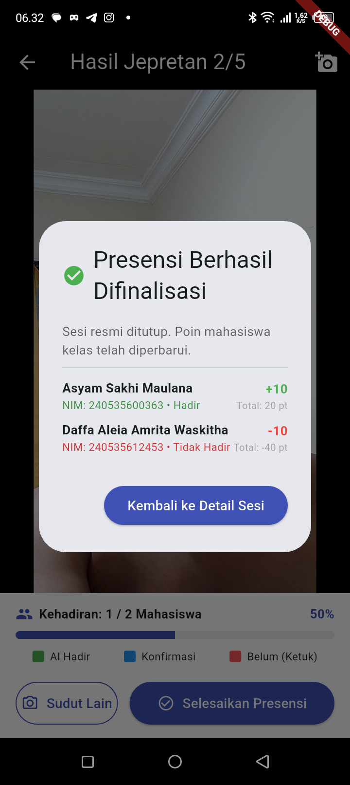
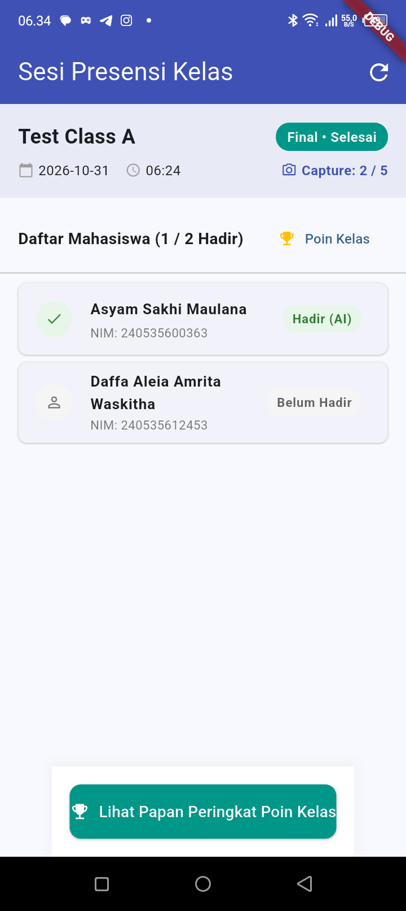
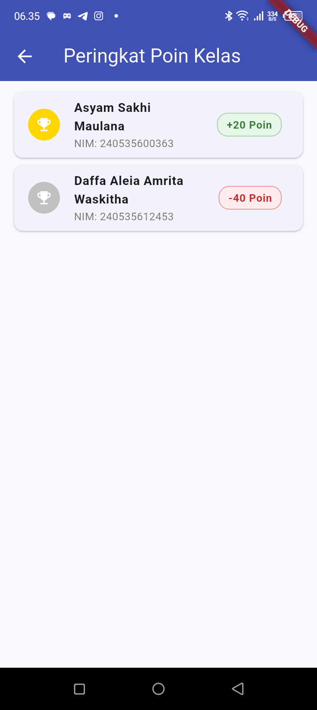
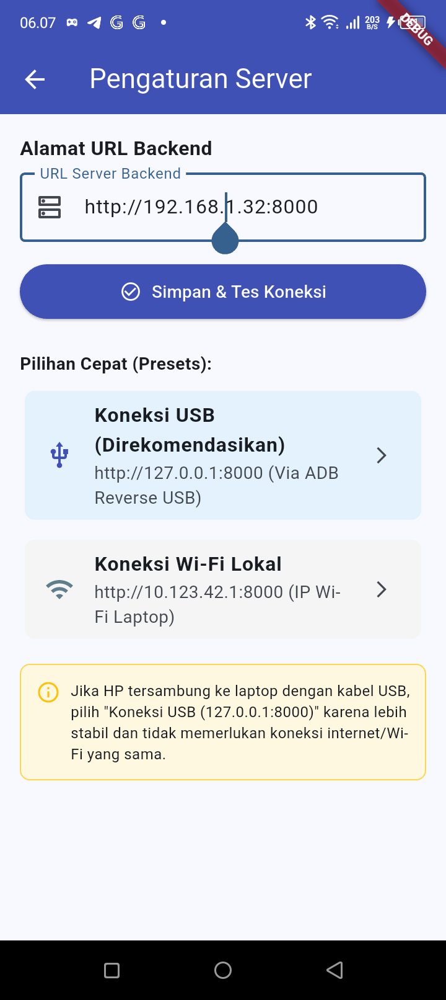
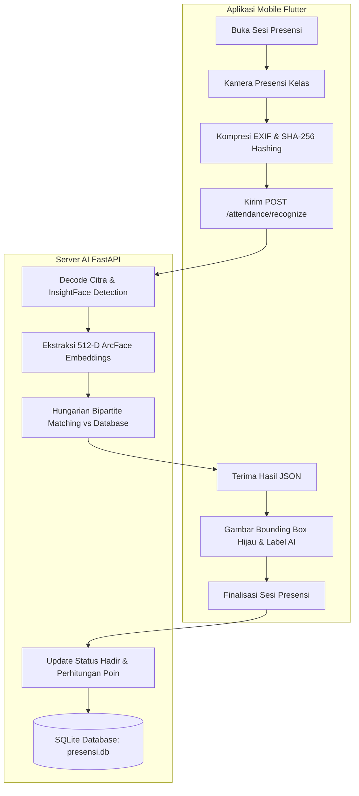

# 🎓 Sistem Presensi Kelas Otomatis Berbasis Pengenalan Wajah AI (Face Attendance System)

<div align="center">


<p align="center">
  <b>Solusi Cerdas Presensi Mahasiswa Cepat, Akurat, dan Anti-Titip Absen Menggunakan Deep Learning Multi-Face Recognition, Edge AI, dan Gamifikasi Poin Disiplin.</b>
</p>

</div>

---

## 📌 Daftar Isi
1. [Ringkasan Eksekutif](#-ringkasan-eksekutif)
2. [Fitur-Fitur Utama](#-fitur-fitur-utama)
3. [Galeri Demo & Tangkapan Layar](#-galeri-demo--tangkapan-layar)
4. [Arsitektur Sistem & Alur Pengenalan Wajah](#-arsitektur-sistem--alur-pengenalan-wajah)
5. [Panduan Penggunaan (Manual Book)](#-panduan-penggunaan-manual-book)
6. [Panduan Instalasi & Menjalankan Sistem](#-panduan-instalasi--menjalankan-sistem)
7. [Mode Konektivitas (USB vs Wi-Fi LAN)](#-mode-konektivitas-usb-vs-wi-fi-lan)
8. [Dokumentasi RESTful API Backend](#-dokumentasi-restful-api-backend)
9. [Struktur Repositori](#-struktur-repositori)
10. [Lisensi & Penulis](#-lisensi--penulis)

---

## 💡 Ringkasan Eksekutif

Presensi manual mahasiswa di perkuliahan konvensional seringkali memakan waktu berharga dosen (10–15 menit tiap pertemuan) dan rentan terhadap kecurangan "titip absen". 

**Sistem Presensi Kelas Otomatis Berbasis Pengenalan Wajah AI** hadir sebagai solusi mutakhir:
* **Hanya Butuh 1–2 Kali Jepret Foto Kelas**: Dosen/petugas cukup memotret mahasiswa di ruangan kelas.
* **Batch Multi-Face AI Recognition**: Mesin AI InsightFace (*ArcFace Buffalo_L*) mendeteksi puluhan wajah sekaligus dalam resolusi tinggi, mengekstrak 512-dimensi *embedding*, dan mencocokkannya ke database mahasiswa secara paralel.
* **Algoritma Hungarian Bipartite Matching**: Menjamin tidak ada mahasiswa ganda yang terabsensi pada dua wajah berdekatan.
* **Sistem Poin & Papan Peringkat (*Gamification*)**: Memberikan reward kedisiplinan (+10 poin per kehadiran, -10 poin jika alpa) yang terpantau pada Leaderboard kelas.

---

## 🚀 Fitur-Fitur Utama

* 📸 **Batch Multi-Face Detection**: Mampu mendeteksi dan mengenali puluhan wajah mahasiswa sekaligus dalam satu foto sudut kelas (*classroom wide-angle capture*).
* 🎯 **Algoritma Hungarian (Bipartite Graph Matching)**: Optimasi penugasan wajah global untuk akurasi pencocokan 1-to-1 yang adil tanpa duplikasi.
* 🔄 **Merge-Max Multi-Capture (Hingga 5 Sudut Foto)**: Dosen dapat mengambil foto dari sudut depan, tengah, kiri, dan kanan. Sistem secara otomatis menggabungkan skor tertinggi (*highest similarity score*) dari tiap mahasiswa.
* 🟢 **Visual Bounding Box & Label AI**: Layar hasil foto menampilkan kotak hijau interaktif (*Green Bounding Box*) dengan nama mahasiswa dan persentase kemiripan AI (misal: `Asyam Sakhi Maulana (79%)`).
* 🖐️ **Verifikasi Manual Cepat**: Jika ada wajah yang belum terdaftar atau tingkat kemiripan di bawah ambang batas (kotak merah), dosen dapat mengetuk kotak tersebut untuk mencocokkan secara manual dari daftar roster.
* 🏆 **Leaderboard & Sistem Poin Otomatis**: Integrasi langsung dengan modul *Point History* untuk merekam riwayat kedisiplinan mahasiswa.
* 📶 **Fleksibilitas Jaringan Ganda (Dual-Mode)**:
  * **Mode USB Reverse Tethering**: 100% *offline*, tanpa koneksi internet, tanpa Wi-Fi, dan aman dari blokir firewall kampus.
  * **Mode Wi-Fi Direct LAN**: Komunikasi nirkabel penuh (*Full Wireless*) melalui jaringan Wi-Fi lokal berlatensi rendah.

---

## 📱 Galeri Demo & Tangkapan Layar

Berikut adalah dokumentasi visual hasil pengujian *end-to-end* sistem secara nyata pada perangkat Android:

| 1. Menu Utama Aplikasi | 2. Mulai Sesi Presensi | 3. Kamera Viewfinder Kelas | 4. Hasil Pengenalan AI |
| :---: | :---: | :---: | :---: |
|  |  |  |  |
| *Navigasi cepat ke presensi, manajemen kelas, & registrasi wajah.* | *Pemilihan kelas, jadwal pertemuan, dan verifikasi status wajah roster.* | *Komposisi panduan grid Rule-of-Thirds & kontrol kamera instan.* | *Bounding Box hijau AI presisi dengan identitas & persentase kemiripan.* |

| 5. Dialog Kunci Presensi | 6. Detail Sesi Terkunci | 7. Papan Peringkat Kelas | 8. Pengaturan Server Fleksibel |
| :---: | :---: | :---: | :---: |
|  |  |  |  |
| *Konfirmasi penguncian presensi & kalkulasi poin resmi (+10 / -10).* | *Status sesi resmi ditutup (Final • Selesai) dengan rekap kehadiran.* | *Leaderboard mahasiswa terupdate secara real-time dengan medali poin.* | *Pilihan preset koneksi instan USB ADB Reverse atau Wi-Fi LAN.* |

---

## 🏗️ Arsitektur Sistem & Alur Pengenalan Wajah

Sistem memadukan komputasi ringan di sisi perangkat bergerak (*Client-Side Edge AI*) dengan kecerdasan komputasi mendalam di sisi server (*Server-Side Deep Learning*):



### Komponen Kunci:
1. **Google ML Kit Vision (Mobile)**: Digunakan saat registrasi wajah untuk memastikan kualitas foto, deteksi *single-face*, dan sudut kemiringan wajah (*head pose Euler angles*).
2. **InsightFace Buffalo_L (Backend)**: Model deep learning berkinerja tinggi untuk *facial landmark detection* dan ekstraksi representasi vektor 512 dimensi (*ArcFace*).
3. **Hungarian Algorithm (Scipy Linear Sum Assignment)**: Algoritma pencocokan graf bipartit berbobot untuk memasangkan vektor wajah deteksi dengan vektor wajah mahasiswa terdaftar secara optimal dengan meminimalkan kesalahan identifikasi.

---

## 📖 Panduan Penggunaan (Manual Book)

### A. Untuk Dosen / Petugas Presensi
1. **Buka Aplikasi**: Pilih menu **Mulai Presensi Kelas** pada beranda.
2. **Tentukan Sesi**:
   * Pilih mata kuliah / kelas yang diajar (misal: `Test Class A`).
   * Tentukan nomor pertemuan ke berapa (misal: `Pertemuan 1`).
   * Tekan tombol **▶ Mulai Sesi Presensi**.
3. **Pengambilan Foto Kehadiran**:
   * Tekan tombol **📷 Ambil Foto Presensi**.
   * Arahkan kamera HP ke barisan mahasiswa di kelas.
   * Tekan tombol *Shutter* putih di bagian bawah.
   * *(Opsional)* Jika ruangan kelas luas atau berbentuk L, tekan tombol **📷 Sudut Lain** untuk memotret sisi kiri/kanan kelas (maksimal 5 foto per sesi).
4. **Tinjau Hasil Pengenalan AI**:
   * Mahasiswa yang berhasil dikenali akan memiliki **kotak hijau** beserta nama dan skor akurasinya.
   * Jika ada mahasiswa yang bertanda merah (*Unknown*), dosen dapat mengetuk kotak wajah tersebut dan memilih nama mahasiswa secara manual.
5. **Finalisasi & Poin**:
   * Tekan tombol **✔ Selesaikan Presensi**.
   * Tekan **Selesaikan & Kunci** pada dialog konfirmasi.
   * Sistem otomatis mencatat kehadiran permanen dan menambahkan **+10 Poin** bagi yang hadir serta mengurangkan **-10 Poin** bagi yang alpa.
   * Buka **🏆 Lihat Papan Peringkat Poin Kelas** untuk melihat posisi peringkat mahasiswa di kelas.

### B. Untuk Mahasiswa (Registrasi Wajah Awal)
1. Pilih menu **Registrasi Wajah Mahasiswa** pada beranda.
2. Masukkan NIM resmi mahasiswa untuk verifikasi data.
3. Ikuti panduan pengambilan **5 Pose Wajah** yang dipandu otomatis oleh sistem:
   * Pose 1: Wajah menghadap lurus ke depan.
   * Pose 2: Menoleh sedikit ke kiri (~15°).
   * Pose 3: Menoleh sedikit ke kanan (~15°).
   * Pose 4: Menengadah sedikit ke atas (~10°).
   * Pose 5: Menunduk sedikit ke bawah (~10°).
4. Sistem memvalidasi konsistensi fitur wajah (*self-similarity*) dan menyimpan vektor wajah terenkripsi ke database server.

---

## 💻 Panduan Instalasi & Menjalankan Sistem

### Prasyarat Perangkat Lunak:
* **Python**: Versi 3.10 atau 3.11 (Disarankan).
* **Flutter SDK**: Versi 3.24+ / 3.x.
* **Android SDK & Platform Tools (ADB)**.
* **Git**.

---

### 1. Menjalankan Backend Server (FastAPI)

1. Buka terminal dan masuk ke direktori `backend`:
   ```bash
   cd backend
   ```
2. Buat dan aktifkan *Virtual Environment*:
   ```bash
   # Windows PowerShell
   python -m venv .venv
   .\.venv\Scripts\activate
   ```
3. Pasang semua dependensi yang diperlukan:
   ```bash
   pip install -r requirements.txt
   ```
4. Jalankan server FastAPI:
   ```bash
   # Cara 1: Menggunakan skrip bawaan
   run_backend.bat

   # Cara 2: Perintah manual
   uvicorn app.main:app --host 0.0.0.0 --port 8000 --reload
   ```
5. Akses dokumentasi interaktif Swagger UI di peramban:
   👉 **`http://localhost:8000/docs`**

---

### 2. Menjalankan Aplikasi Mobile (Flutter Android)

1. Buka terminal baru dan masuk ke direktori `mobile`:
   ```bash
   cd mobile
   ```
2. Unduh paket dependensi Flutter:
   ```bash
   flutter pub get
   ```
3. Jalankan aplikasi pada perangkat Android HP fisik:
   ```bash
   flutter run
   ```

---

## 🔌 Mode Konektivitas (USB vs Wi-Fi LAN)

Aplikasi telah dilengkapi layar **Pengaturan Server** fleksibel yang dapat diakses melalui ikon gerigi ⚙️ di pojok kanan atas beranda:

### Opsi 1: Mode USB Kabel (ADB Reverse) — Paling Stabil & 100% Offline
Sangat cocok untuk lingkungan kampus dengan jaringan Wi-Fi berkeamanan tinggi yang memblokir komunikasi antardevice (*AP Client Isolation*).
1. Sambungkan HP ke laptop menggunakan kabel USB (pastikan *USB Debugging* aktif).
2. Jalankan perintah *reverse port forwarding* di terminal laptop:
   ```bash
   adb reverse tcp:8000 tcp:8000
   ```
3. Di aplikasi HP, buka **Pengaturan Server** -> pilih preset **Koneksi USB (127.0.0.1)**.
4. Tekan **Simpan & Tes Koneksi** hingga muncul notifikasi hijau `Koneksi Berhasil!`.

### Opsi 2: Mode Wi-Fi Lokal / LAN (Full Wireless)
Cocok digunakan jika laptop dan HP terhubung pada satu router Wi-Fi lokal yang sama (misalnya Wi-Fi Kost atau Hotspot Portabel HP).
1. Cek alamat IP lokal laptop Anda melalui `ipconfig` (misal: `192.168.1.32`).
2. Di aplikasi HP, buka **Pengaturan Server** -> masukkan URL: `http://192.168.1.32:8000`.
3. Tekan **Simpan & Tes Koneksi** hingga muncul notifikasi hijau `Koneksi Berhasil!`.

---

## 📡 Dokumentasi RESTful API Backend

| Metode | Endpoint | Deskripsi | Status Sukses |
| :---: | :--- | :--- | :---: |
| `GET` | `/health` | Pemeriksaan kesehatan server & status model AI | `200 OK` |
| `GET` | `/classes` | Mengambil daftar seluruh kelas & mata kuliah | `200 OK` |
| `POST` | `/students/register-face` | Mendaftarkan 5 vektor pose wajah mahasiswa | `201 Created` |
| `POST` | `/sessions` | Membuka sesi presensi kelas baru | `201 Created` |
| `GET` | `/sessions/{id}` | Mengambil detail peserta & status kehadiran sesi | `200 OK` |
| `POST` | `/attendance/recognize` | Mengunggah foto kelas & pencocokan wajah massal AI | `200 OK` |
| `POST` | `/sessions/{id}/finalize` | Menutup sesi secara resmi & menghitung poin | `200 OK` |
| `GET` | `/points?class_id={id}` | Mengambil data Leaderboard peringkat poin kelas | `200 OK` |

---

## 📁 Struktur Repositori

```text
apilkasi-absensi/
├── backend/                        # Layanan Backend AI (Python / FastAPI)
│   ├── app/
│   │   ├── core/                   # Konfigurasi, Database Engine, & Error Handling
│   │   ├── models/                 # Model Tabel SQLAlchemy ORM
│   │   ├── routers/                # Endpoint API (Attendance, Classes, Points, Students)
│   │   ├── schemas/                # Skema Validasi Pydantic
│   │   ├── services/               # Mesin InsightFace AI & Algoritma Hungarian
│   │   └── main.py                 # Titik Masuk Utama Aplikasi FastAPI
│   ├── .env                        # Konfigurasi Hyperparameter AI
│   ├── presensi.db                 # Database SQLite Utama
│   ├── requirements.txt            # Daftar Paket Pustaka Python
│   └── run_backend.bat             # Skrip Batch Otomatisasi Menjalankan Server
├── docs/                           # Dokumentasi Proyek & Aset Visual
│   ├── images/                     # Tangkapan Layar Demo Resmi (PNG)
│   ├── DESIGN SPEC ... .md         # Dokumen Spesifikasi Desain Arsitektur Lengkap
│   └── MANUAL_BOOK_PANDUAN ... .md # Dokumen Manual Book Panduan Resmi Dosen & Mahasiswa
├── mobile/                         # Aplikasi Klien Android (Flutter / Dart)
│   ├── lib/
│   │   ├── app/                    # Konfigurasi Tema, Routing, & State Global
│   │   ├── features/
│   │   │   ├── attendance/         # Layar Kamera, Sesi, & Bounding Box AI
│   │   │   ├── classes/            # Manajemen Kelas, Roster, & Papan Peringkat
│   │   │   ├── registration/       # Registrasi 5 Pose Wajah Mahasiswa
│   │   │   └── settings/           # Pengaturan Alamat Server & Preset Jaringan
│   │   └── main.dart               # Titik Masuk Utama Aplikasi Flutter
│   └── pubspec.yaml                # Manajemen Dependensi Flutter
├── .gitignore                      # Konfigurasi Eksklusi File Git
└── README.md                       # Buku Panduan Utama & Demo Repositori (File ini)
```

---

## 📄 Lisensi & Penulis

Proyek ini dikembangkan dan dipelihara sebagai solusi inovasi sistem presensi cerdas berbasis kecerdasan buatan (*Artificial Intelligence*).

* **Pengembang**: Asyam Sakhi Maulana & Tim
* **Institusi**: Universitas Negeri Malang (UM)
* **Lisensi**: Terdistribusi di bawah lisensi terbuka [MIT License](LICENSE).

<div align="center">
  <sub>Dibuat dengan ❤️ untuk kemajuan efisiensi dan transparansi pendidikan Indonesia.</sub>
</div>
