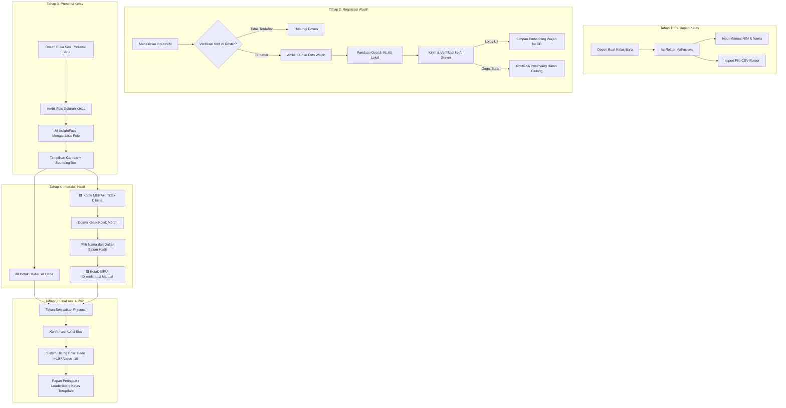

# BUKU PANDUAN PENGGUNA (MANUAL BOOK)
# APLIKASI PRESENSI KELAS OTOMATIS BERBASIS PENGENALAN WAJAH AI

> **Versi Dokumentasi:** 1.0 (Final - Fase 1 s/d Fase 6 Selesai)  
> **Pengembang / Penulis:**  
> - Asyam Sakhi Maulana (NIM: 240535600363)  
> - Daffa Aleia Amrita Waskitha (NIM: 240535612453)  
> **Teknologi Utama:** Flutter (Mobile Android), Python FastAPI (Backend Server), InsightFace & Google ML Kit (AI Face Recognition), SQLite WAL (Database).

---

## DAFTAR ISI
1. [Gambaran Umum Sistem](#1-gambaran-umum-sistem)
2. [Arsitektur & Konsep Alur Presensi](#2-arsitektur--konsep-alur-presensi)
3. [Panduan Menjalankan Sistem (Setup Awal)](#3-panduan-menjalankan-sistem-setup-awal)
4. [Modul 1: Manajemen Kelas & Roster Mahasiswa](#4-modul-1-manajemen-kelas--roster-mahasiswa)
5. [Modul 2: Registrasi Wajah Mahasiswa (Kamera Depan)](#5-modul-2-registrasi-wajah-mahasiswa-kamera-depan)
6. [Modul 3: Presensi Kelas Massal (Kamera Belakang)](#6-modul-3-presensi-kelas-massal-kamera-belakang)
7. [Modul 4: Hasil Deteksi AI & Bounding Box Interaktif](#7-modul-4-hasil-deteksi-ai--bounding-box-interaktif)
8. [Modul 5: Finalisasi Sesi & Leaderboard Poin](#8-modul-5-finalisasi-sesi--leaderboard-poin)
9. [Manajemen Database & Panduan Reset dari Nol](#9-manajemen-database--panduan-reset-dari-nol)
10. [Troubleshooting & Tanya Jawab (FAQ)](#10-troubleshooting--tanya-jawab-faq)

---

## 1. Gambaran Umum Sistem

Aplikasi Presensi Kelas Otomatis adalah solusi presensi cerdas berbasis kecerdasan buatan (*Artificial Intelligence*) yang dirancang khusus untuk mempermudah dosen dalam mencatat kehadiran mahasiswa dalam satu jepretan foto grup kelas (*group photo*).

### Fitur Unggulan:
* **Deteksi Wajah Massal Sekaligus:** Cukup memotret seisi kelas, AI akan mendeteksi dan mengenali seluruh mahasiswa yang hadir secara simultan.
* **Algoritma Pencocokan Presisi Tinggi:** Menggunakan model deep learning *InsightFace* (ekstraksi vektor embedding 512 dimensi) dipadukan dengan *Hungarian Algorithm* untuk mencegah duplikasi pencocokan wajah.
* **Interaksi Sentuh (Manual Verification):** Jika terdapat mahasiswa yang wajahnya tidak terdeteksi otomatis, dosen cukup mengetuk kotak wajah di layar untuk mengonfirmasi kehadirannya secara instan.
* **Sistem Gamifikasi Poin:** Mahasiswa yang hadir mendapatkan **+10 Poin**, sedangkan mahasiswa yang tidak hadir mendapatkan **-10 Poin** secara otomatis dengan papan peringkat (*Leaderboard*).
* **Mode Offline-First:** Pendaftaran wajah tetap dapat dilakukan meskipun koneksi server terganggu melalui sistem antrean latar belakang (*SQLite Queue Worker*).

---

## 2. Arsitektur & Konsep Alur Presensi

Berikut adalah diagram alur menyeluruh mulai dari pendaftaran kelas hingga penutupan sesi presensi:



---

## 3. Panduan Menjalankan Sistem (Setup Awal)

Sistem menggunakan arsitektur **Client-Server**:
* **Backend:** Berjalan di Laptop/PC lokal (Python FastAPI).
* **Mobile App:** Berjalan di HP Android dosen (Flutter).

### Langkah Menjalankan:
1. **Hubungkan HP Android ke Laptop menggunakan Kabel USB**:
   * Pastikan *USB Debugging* di menu Pengaturan Pengembang HP aktif.
2. **Jalankan Port Forwarding (ADB Reverse)**:
   ```powershell
   adb reverse tcp:8000 tcp:8000
   ```
   *(Langkah ini membuat HP dapat mengakses server backend di alamat `http://127.0.0.1:8000` via USB secara stabil tanpa terpengaruh jaringan Wi-Fi).*
3. **Jalankan Server Backend**:
   * Masuk ke folder `backend/`, aktifkan virtual environment, lalu jalankan:
     ```powershell
     .\.venv\Scripts\python.exe -m uvicorn app.main:app --host 0.0.0.0 --port 8000 --reload
     ```
   * Jika server aktif, buka browser dan periksa `http://127.0.0.1:8000/health` (harus mengembalikan `{"status": "ok", "model_loaded": true}`).
4. **Jalankan Aplikasi Mobile di HP**:
   * Buka terminal di folder `mobile/`, lalu jalankan:
     ```powershell
     flutter run
     ```
   * Pilih perangkat Android fisik Anda.

---

## 4. Modul 1: Manajemen Kelas & Roster Mahasiswa

Menu ini digunakan oleh dosen sebelum perkuliahan dimulai untuk mendata kelas dan mahasiswa yang mengambil mata kuliah.

### A. Membuat Kelas Baru:
1. Pada Beranda, pilih kartu **"Manajemen Kelas & Roster"**.
2. Tekan tombol **"Tambah Kelas Baru"** (atau ikon tambah di pojok kanan atas).
3. Masukkan **Nama Kelas** (misal: *Pemrograman Visual*) dan **Kode Kelas Opsional** (misal: *PV-A*).
4. Tekan **"Simpan"**.

### B. Menambahkan Mahasiswa ke Roster:
Buka kelas yang telah dibuat. Terdapat dua metode:
1. **Tambah Manual**:
   * Tekan tombol **"Tambah Manual"**.
   * Masukkan **NIM** (tepat 12 digit angka) dan **Nama Lengkap Mahasiswa**.
   * Tekan **"Simpan"**.
2. **Import Roster dari CSV**:
   * Siapkan file spreadsheet yang diekspor menjadi format `.csv` dengan header: `nim,full_name`.
   * Tekan tombol **"Import CSV"** dan pilih file.
   * Aplikasi akan otomatis membaca data dan menampilkan dialog ringkasan: jumlah mahasiswa yang berhasil ditambahkan.

> 📌 **Lencana Status Wajah (Status Badge):**  
> Pada daftar mahasiswa di Roster, akan terlihat lencana:
> * 🟠 **Belum Terdaftar**: Mahasiswa belum melakukan registrasi foto wajah.
> * 🟢 **Wajah Terdaftar**: Mahasiswa sudah mendaftarkan 5 pose wajah dan siap dikenali AI saat presensi.

---

## 5. Modul 2: Registrasi Wajah Mahasiswa (Kamera Depan)

Setiap mahasiswa cukup melakukan registrasi wajah **satu kali** per semester secara bergantian menggunakan HP dosen.

### Langkah-langkah Registrasi:
1. Pada Beranda, pilih menu **"Registrasi Wajah Mahasiswa"**.
2. Masukkan **12 digit NIM** mahasiswa -> Tekan **"Cari & Verifikasi"**.
3. Sistem akan memverifikasi ke database:
   * Jika NIM terdaftar di kelas, nama mahasiswa dan kelasnya akan muncul di layar.
   * Tekan **"Lanjut Pendaftaran Wajah"**.
   *(Catatan: Jika wajah sudah pernah terdaftar, dosen/mahasiswa akan diminta konfirmasi apakah ingin melakukan daftar ulang/overwrite data lama).*
4. **Pengambilan 5 Pose Wajah Interaktif (Kamera Depan)**:
   Mahasiswa memosisikan wajahnya di dalam **lingkaran oval panduan**:
   * **Pose 1 - Hadap Depan**: Posisikan wajah lurus menghadap kamera.
   * **Pose 2 - Tengok Kiri**: Tengokkan kepala sedikit ke kiri.
   * **Pose 3 - Tengok Kanan**: Tengokkan kepala sedikit ke kanan.
   * **Pose 4 - Angkat Dagu**: Dongakkan kepala sedikit ke atas.
   * **Pose 5 - Tunduk Sedikit**: Tundukkan kepala sedikit ke bawah.
5. **Auto-Capture & Verifikasi AI**:
   * Kamera dilengkapi deteksi kualitas lokal (Google ML Kit): otomatis mendeteksi apakah wajah buram, terlalu gelap, atau miring.
   * Saat posisi pas, indikator oval akan berubah **Hijau** dan otomatis menjepret foto.
   * Setelah kelima pose lengkap, sistem langsung mengirimkan foto ke server InsightFace.
   * Jika berhasil, muncul dialog konfirmasi: **"Wajah Berhasil Disimpan!"**.

> 💡 **Tips Kualitas Wajah:**  
> Lakukan registrasi di ruangan dengan pencahayaan merata. Hindari backlight (membelakangi jendela terang) atau rambut menutupi mata/dahi.

---

## 6. Modul 3: Presensi Kelas Massal (Kamera Belakang)

Digunakan oleh dosen pada jam perkuliahan untuk memotret kehadiran kelas.

### Langkah Presensi:
1. Pada Beranda, pilih **"Mulai Presensi Kelas"**.
2. Pilih kelas yang sedang berlangsung dari dropdown daftar kelas.
3. Masukkan **Nama Kegiatan / Topik Kuliah** (misal: *Pertemuan 1 - Pengantar AI*).
4. Tentukan tanggal, waktu, dan nomor pertemuan -> Tekan **"Mulai Sesi Presensi"**.
5. Layar **Kamera Presensi Kelas** akan terbuka:
   * Menggunakan **kamera belakang resolusi tinggi**.
   * Terdapat garis bantu komposisi (*Rule of Thirds*) untuk membantu membagi area kelas.
   * Kuota jepretan maksimal adalah **5 foto per sesi** (untuk memotret sisi kiri kelas, sisi kanan, dan belakang bila kelas berukuran luas).
6. Arahkan kamera ke arah mahasiswa yang sedang duduk, lalu tekan tombol bulat **Shutter Kamera**.
7. Aplikasi akan mengompres foto secara cerdas dan mengirimkannya ke endpoint `POST /attendance/recognize`.

---

## 7. Modul 4: Hasil Deteksi AI & Bounding Box Interaktif

Setelah foto selesai dianalisis oleh AI (sekitar 1–2 detik), layar **Hasil Presensi** akan menampilkan foto kelas dengan kotak (*Bounding Box*) di atas setiap wajah yang terdeteksi.

### 🎨 Arti 3 Kode Warna Kotak Bounding Box:

| Warna Kotak | Status | Penjelasan | Tindakan Dosen |
|---|---|---|---|
| 🟩 **HIJAU** | **AI Hadir** (*Identified*) | Wajah mahasiswa berhasil dicocokkan otomatis oleh AI dengan database. Nama mahasiswa dan persentase kemiripan muncul di atas kotak. | Tidak perlu tindakan apa pun. Kehadiran sudah tercatat otomatis. |
| 🟥 **MERAH** | **Tidak Dikenal** (*Unknown*) | Wajah terdeteksi oleh kamera, namun belum cocok dengan database (misal: mahasiswa belum setor foto saat registrasi, atau wajah tertutup masker/tangan). | **Ketuk kotak merah tersebut** untuk verifikasi manual. |
| 🟦 **BIRU** | **Dikonfirmasi Manual** (*Confirmed*) | Wajah yang sebelumnya berwarna merah telah diketuk oleh dosen dan dicocokkan dengan nama mahasiswa yang hadir. | Mahasiswa resmi berstatus hadir via konfirmasi dosen. |

### 👆 Cara Melakukan Konfirmasi Manual:
1. Temukan kotak wajah berwarna **MERAH** pada foto.
2. **Ketuk langsung kotak merah tersebut** di layar HP.
3. Lembar bawah (*Bottom Sheet*) akan muncul menampilkan daftar mahasiswa di kelas tersebut yang **belum terdeteksi hadir**.
4. Gunakan kolom pencarian untuk mengetikkan nama atau NIM mahasiswa.
5. Ketuk nama mahasiswa yang bersangkutan:
   * Kotak wajah seketika berubah warna menjadi **BIRU (✓)**.
   * Bar progres kehadiran di bawah layar otomatis bertambah.

### 📸 Mengambil Foto Sudut Lain:
Jika masih ada mahasiswa di sudut ruangan lain yang belum masuk ke dalam foto pertama, tekan tombol **"Sudut Lain"** di kiri bawah untuk mengambil jepretan ke-2 (maksimal 5 kali jepret per sesi). Hasil deteksi dari seluruh jepretan akan digabungkan secara otomatis (*Merge-Max Attendance*).

---

## 8. Modul 5: Finalisasi Sesi & Leaderboard Poin

Setelah seluruh mahasiswa yang berada di kelas selesai dipotret atau dikonfirmasi manual:

1. Tekan tombol **"Selesaikan Presensi"** di bagian kanan bawah.
2. Dialog konfirmasi akan muncul menampilkan perkiraan aturan poin:
   * **Mahasiswa Hadir:** Memperoleh **+10 Poin**.
   * **Mahasiswa Tidak Hadir (Absen):** Dikenakan pinalti **-10 Poin**.
3. Tekan **"Selesaikan & Kunci"**.
4. **Sesi Resmi Dikunci (*Finalized*):**
   * Server mengeksekusi transaksi tunggal untuk mengunci daftar kehadiran.
   * Mahasiswa yang tidak terdeteksi otomatis ditetapkan berstatus `tidak_hadir`.
   * Riwayat poin permanen dicatat ke tabel `point_history`.
5. Dialog **Ringkasan Akhir** akan menampilkan seluruh daftar mahasiswa kelas beserta perolehan poin sesi ini dan total akumulasi poinnya.
6. **Papan Peringkat Kelas (*Leaderboard*):**
   * Dosen dan mahasiswa dapat melihat peringkat keaktifan kelas melalui menu **"Papan Peringkat Poin"**.
   * Peringkat 1 mendapat medali 🥇 **Emas**, peringkat 2 🥈 **Perak**, dan peringkat 3 🥉 **Perunggu**.

---

## 9. Manajemen Database & Panduan Reset dari Nol

### A. Lokasi Penyimpanan Data:
* **Database SQLite Server:** `backend/presensi.db` (beserta file pendukung `presensi.db-wal` dan `presensi.db-shm`).
* **Folder File Foto:** `backend/storage/` (berisi file gambar hasil jepretan presensi kelas berbasis UUID).
* **Database Antrean Mobile:** SQLite lokal di HP (`upload_queue.db`) yang dikelola otomatis oleh aplikasi.

### B. Cara Mereset Database Menjadi Bersih (Fresh dari Nol):
Jika semester berganti atau Anda ingin menghapus seluruh data simulasi pengujian untuk memulai dari awal:

#### ⚡ Opsi 1: Menggunakan Script Otomatis 1-Klik (Rekomendasi)
1. Buka folder `backend/` di Windows Explorer.
2. Klik 2x file **`reset_db.bat`**.
3. Script akan otomatis:
   * Menghapus file `presensi.db` lama beserta file log WAL.
   * Membersihkan semua foto lama di folder `backend/storage/`.
   * Menjalankan generator skema untuk membangun ulang seluruh tabel kosong yang baru dan bersih.

#### 🛠️ Opsi 2: Reset Manual via Terminal
```powershell
cd d:\apilkasi-absensi\backend
.\.venv\Scripts\python.exe reset_db.py
```

#### 📱 Reset di Sisi HP Android:
Buka HP Anda -> Masuk ke **Pengaturan** -> **Aplikasi** -> Pilih **Presensi Wajah** -> **Penyimpanan** -> Tekan **"Hapus Data"** (*Clear Storage*).

---

## 10. Troubleshooting & Tanya Jawab (FAQ)

### Q1: Mengapa saat registrasi wajah muncul pesan "Wajah tidak terdeteksi oleh AI"?
**Penyebab:** Sudut kemiringan wajah terlalu ekstrem atau wajah kekurangan cahaya (gelap).  
**Solusi:** Pastikan wajah berada di area terang dan mahasiswa tidak membelakangi sumber cahaya langsung (*backlight*). Posisikan kepala mengikuti instruksi oval tanpa memiringkan kepala lebih dari 30 derajat.

### Q2: Mengapa saat memotret kelas, wajah mahasiswa ditandai kotak Merah (Unknown)?
**Penyebab:** Mahasiswa tersebut belum pernah melakukan registrasi 5 pose wajah, atau wajah mahasiswa tertutup masker/posisi menunduk terlalu dalam saat dosen memotret.  
**Solusi:** Dosen cukup mengetuk kotak merah tersebut pada layar, lalu memilih nama mahasiswa dari daftar untuk mengubah statusnya menjadi **Biru (Dikonfirmasi Manual)**.

### Q3: Apakah dosen bisa memotret lebih dari satu kali jika kelasnya besar?
**Bisa.** Dosen dapat memotret hingga **5 kali capture** per sesi pertemuan. Tekan tombol **"Sudut Lain"** untuk memotret sisi kelas yang berbeda. AI akan menggabungkan semua mahasiswa yang terdeteksi di setiap foto.

### Q4: Apakah aplikasi bisa berjalan tanpa koneksi internet kampus?
**Bisa 100%.** Sistem ini didesain *Local Area Network (LAN)*. Dosen hanya perlu menghubungkan HP ke Laptop melalui kabel USB (ADB Reverse) atau terhubung ke hotspot Wi-Fi portabel yang sama antara laptop dan HP. Tidak memerlukan kuota internet publik.

---

> **Dokumen ini disusun untuk melengkapi berkas teknis Tugas Akhir / Proyek Mata Kuliah.**  
> *Sistem Presensi Kelas Otomatis Berbasis Pengenalan Wajah AI (InsightFace & Flutter).*
